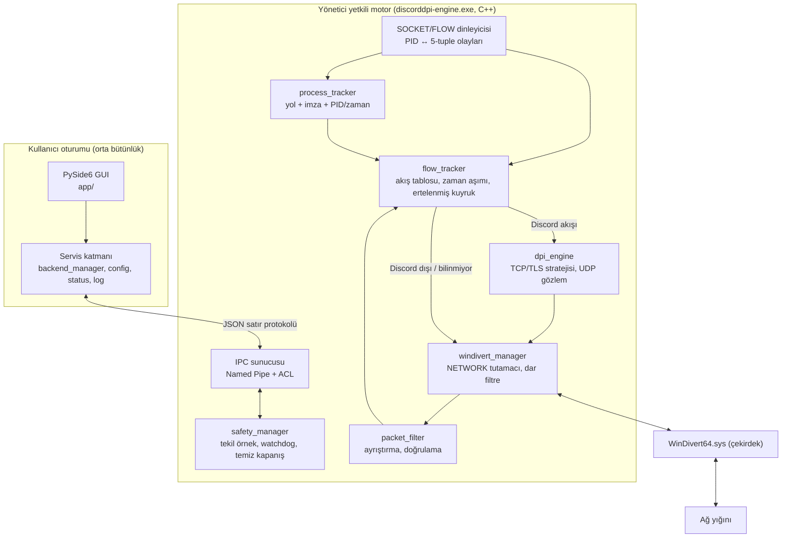
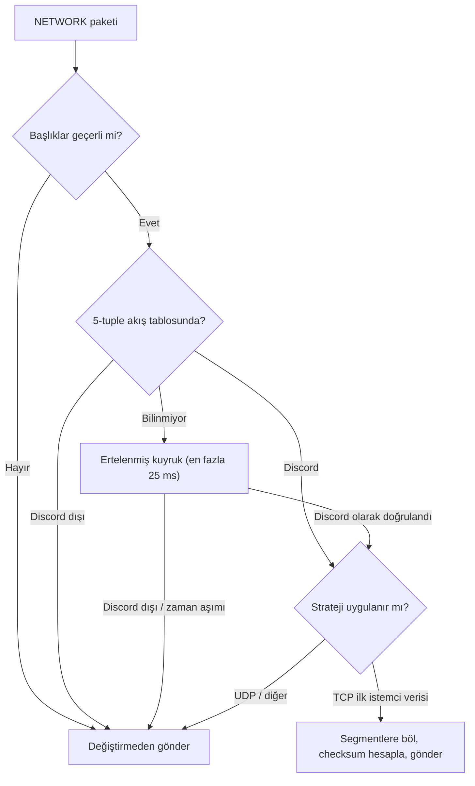

# DiscordDPI — Mimari ve Fizibilite (Faz 1)

> Durum: **Taslak / Faz 1**. Bu belgede "doğrulanacak" olarak işaretlenen her madde,
> Faz 2–3'te gerçek ölçümle teyit edilmeden "çalışıyor" kabul edilmeyecektir.

---

## 1. Ortam tespiti (gerçek çıktılardan)

| Bileşen | Durum |
|---|---|
| İşletim sistemi | Windows 11 Pro, build 26300, x64 |
| Python | 3.14.7 (x64) — gereksinim 3.12+ karşılanıyor |
| PySide6 / pytest / psutil | 6.11.2 / 9.1.1 / 7.2.2 kurulu |
| Discord | `%LOCALAPPDATA%\Discord\app-1.0.9266\Discord.exe` |
| Discord imzası | `Discord.exe`, `Update.exe`, `updater_launcher.exe` → **Valid, CN=Discord Inc.** |
| C++ derleyici / CMake / Git | **Yok** — Faz 3 öncesi kurulmalı (VS 2022 Build Tools + CMake) |

---

## 2. Temel teknik gerçekler ve sınırlar

### 2.1 WinDivert katmanları

| Katman | Paket içeriği | PID | Değiştirme/Enjekte | Kullanımımız |
|---|---|---|---|---|
| `NETWORK` | Var | **Yok** (her zaman 0) | Var | Yalnızca eşleşmiş akışların paketlerini işlemek |
| `SOCKET` | Yok (olay) | Var | Yok (`RECV_ONLY` zorunlu) | `CONNECT`/`BIND`/`CLOSE` → PID ↔ 5-tuple, **SYN'den önce** |
| `FLOW` | Yok (olay) | Var | Yok (`SNIFF+RECV_ONLY`) | `ESTABLISHED`/`DELETED` → doğrulama ve temizlik |

**Sonuç:** NETWORK katmanında PID filtresi **yoktur ve yazılmayacaktır.** PID bilgisi
SOCKET/FLOW olaylarından alınır, kullanıcı alanındaki akış tablosunda 5-tuple ile eşleştirilir.

### 2.2 İlk paket yarış durumu (açıkça)

- SOCKET/FLOW olayları kullanıcı alanına **asenkron** gelir. Paket yolu olayı beklemez.
- **TCP için risk düşük ama sıfır değil:** `SOCKET_CONNECT` olayı `connect()` anında (SYN'den önce)
  üretilir. DPI'ın baktığı paket olan TLS ClientHello ise SYN → SYN-ACK → ACK sonrası, yani
  en az **1 RTT sonra** gönderilir. Olay işleme mikrosaniye, RTT milisaniye mertebesindedir.
- **UDP için risk gerçek:** İlk `sendto()` paketi ile `CONNECT` olayı neredeyse eş zamanlıdır.

**Çözüm — "ertelenmiş sınıflandırma" (deferred classification):**
1. NETWORK tutamacı, 5-tuple'ı akış tablosunda bulunmayan bir aday paket yakalarsa paketi
   sınırlı bir bekleme kuyruğuna alır (varsayılan 25 ms, en fazla N paket).
2. Bu sürede SOCKET olayı gelip akışı **Discord** olarak doğrularsa → paket işlenir.
3. Akış **Discord dışı** çıkarsa → paket **anında, değiştirilmeden** geri enjekte edilir.
4. Zaman aşımı olursa → paket **değiştirilmeden** geri enjekte edilir (güvenlik kuralı).
5. Her sonuç sayaçlanır (`pending_hit`, `pending_timeout`) ve tanılama ekranında gösterilir.
   Böylece kaçırılan ilk paket oranı gizlenmez, ölçülür.

### 2.3 "Discord dışı trafiğe hiç dokunulmaması" — gerçekçi tanım

WinDivert NETWORK katmanında süreç filtresi olmadığı için **çekirdek filtresi, Discord'a ait
olup olmadığı henüz bilinmeyen bazı paketleri kullanıcı alanına yönlendirmek zorundadır.**
Dürüst garanti şudur:

| Garanti | Durum |
|---|---|
| Discord dışı paketler **değiştirilmez** | ✅ Tasarım kuralı + test edilecek |
| Discord dışı paketlerin **büyük çoğunluğu** kullanıcı alanına hiç gelmez | ✅ Dar çekirdek filtresi ile |
| Discord dışı **aday** paketler (ör. başka uygulamaların TLS ilk paketleri) birkaç µs gecikmeyle geri enjekte edilir | ⚠️ Kaçınılmaz, ölçülüp raporlanacak |
| Motor çökerse ağ bozulmaz | ✅ OS tutamacı kapatır, filtre kalkar; kuyruktaki birkaç paket TCP tarafından yeniden iletilir |

Çekirdek filtresi mümkün olduğunca dar tutulur. Örneğin TCP için yalnızca
**giden, yükü olan ve TLS el sıkışma başlangıcı gibi görünen** paketler yönlendirilir.
Diğer tüm trafik (video akışı, Steam indirmesi, oyun UDP'si) çekirdekte kalır.

### 2.4 DNS sorunu (kritik sınırlama)

Windows'ta ad çözümlemesi çoğunlukla **DNS Client servisi (svchost / Dnscache)** üzerinden yapılır.
DNS sorgusunun kaynak süreci Discord değil svchost'tur. **Bu nedenle DNS trafiği süreç bazlı
Discord'a atfedilemez.** Seçenekler:

| Seçenek | Süreç izolasyonu | Not |
|---|---|---|
| A. Windows'un yerleşik DoH özelliği (kullanıcı ayarı) | Global | Uygulamamız değiştirmez, yalnızca yönlendirir/belgeler |
| B. Yalnızca Discord alan adı sonekleri için DNS sorgularını şifreli çözücüye yönlendirme | **Ad bazlı istisna** | Süreç bazlı değildir; açıkça "istisna" olarak etiketlenir, isteğe bağlı |
| C. Yerel proxy modu (bkz. §4) | Süreç bazlı | Discord ad çözümlemesini proxy'ye devreder |

Karar Faz 2 ölçümüne bağlıdır: ağda DNS müdahalesi yoksa bu katmana hiç gerek kalmaz.

---

## 3. WinDivert vs WFP karşılaştırması

| Ölçüt | WinDivert 2.2 (kullanıcı alanı) | WFP kullanıcı alanı API | WFP callout sürücüsü (kendi) |
|---|---|---|---|
| Paket değiştirme/enjekte | ✅ | ❌ (yalnızca izin/engel) | ✅ |
| Süreç bazlı sınıflandırma | Olay katmanlarından, asenkron | ✅ (`ALE_APP_ID`), senkron | ✅ senkron, yarış yok |
| İmzalı sürücü | ✅ Hazır, imzalı | Sürücü gerekmez | ❌ EV sertifika + Microsoft imzası gerekir |
| Geliştirme maliyeti | Orta | Düşük | Çok yüksek; çekirdek hatası = BSOD |
| Lisans | LGPL-3.0 / GPL-2.0 (DLL dinamik bağlantı uygundur) | — | — |

**Karar:** WinDivert + SOCKET/FLOW olay katmanları + ertelenmiş sınıflandırma.
Kendi WFP callout sürücüsü teknik olarak en doğru yoldur, ama imzalama gereksinimi nedeniyle
bireysel bir proje için dağıtılabilir değildir. Bu yüzden **v2 araştırma konusu** olarak bırakılır.
WFP kullanıcı alanı API'si paket değiştiremediği için DPI motoru olarak kullanılamaz.

---

## 4. Alternatif mimari: Uygulama içi yerel proxy (değerlendirildi)

Discord, Chromium tabanlı bir Electron uygulamasıdır ve Chromium proxy anahtarlarını destekler.
Discord yerel bir proxy üzerinden başlatılırsa:

- ✅ TCP trafiği **tamamen süreç bazlı** olur; diğer uygulamalar proxy'yi hiç görmez.
- ✅ Yönetici izni ve sürücü gerektirmez.
- ✅ Ad çözümlemesi proxy tarafında yapılabildiği için DNS sorunu (§2.4) çözülür.
- ❌ Discord'un ses modülü (native UDP) proxy'yi kullanmaz.
- ❌ Discord kullanıcı tarafından normal kısayoldan açılırsa proxy devre dışı kalır.
- ❌ Discord'un bu anahtarları her sürümde desteklediği **doğrulanmalıdır.**

**Karar:** Birincil mod WinDivert motorudur, çünkü Discord nasıl başlatılırsa başlatılsın çalışır.
Proxy modu, Faz 3 ölçümlerinden sonra **yedek mod** olarak değerlendirilecektir.

---

## 5. Discord bağlantı profili ve protokol stratejileri

> Alan adları yalnızca **test/tanılama** amaçlıdır; filtreleme bunlara dayanmaz.

| Trafik | Taşıma | Örnek uç noktalar (değişebilir) | Strateji |
|---|---|---|---|
| Gateway (mesajlaşma, olaylar) | TCP 443, TLS + WebSocket | gateway.discord.gg | TCP/TLS stratejisi |
| REST API | TCP 443 TLS (HTTP/2), olası HTTP/3 | discord.com | TCP/TLS + QUIC stratejisi |
| CDN, görsel, medya | TCP 443 TLS | cdn.discordapp.com, media.discordapp.net | TCP/TLS stratejisi |
| Dosya yükleme | TCP 443 TLS | Bulut depolama uç noktaları (Discord dışı alan adı olabilir) | Süreç bazlı olduğu için otomatik kapsanır |
| Güncelleme | TCP 443 TLS | `Update.exe` / `updater_launcher.exe` süreçleri | Süreç listesine dahil |
| Ses sinyalleşmesi | TCP 443 TLS + WebSocket | *.discord.media | TCP/TLS stratejisi |
| Ses / görüntü / ekran paylaşımı / Go Live | **UDP** (RTP/RTCP, şifreli; E2EE) | Ses sunucusu IP:port | **UDP stratejisi** |

### 5.1 TCP / TLS stratejisi
- Yalnızca Discord akışının **ilk istemci verisi** (TLS ClientHello) hedeflenir.
- Temel yöntem: ClientHello'yu geçerli TCP segmentlerine bölme. Sıra numaraları, IP uzunluğu,
  IPv4 ID ve tüm checksum'lar yeniden hesaplanır. IPv4 ve IPv6 desteklenir.
- Ek yöntemler (yapılandırılabilir, varsayılan kapalı): ters sırada segment gönderimi,
  TLS kaydı bölme. Hangisinin gerektiği Faz 3'te ölçümle belirlenir.
- El sıkışmadan sonraki şifreli veri **değiştirilmez**; akış `passthrough` durumuna geçer.
- Ayrıştırılamayan veya bozuk paket → değiştirilmeden iletilir, sayaç artırılır.

### 5.2 UDP stratejisi (ses/görüntü)
- Medya paketleri şifrelidir; içerik değiştirmek bağlantıyı bozar, hiçbir fayda sağlamaz.
  **Medya paketlerine dokunulmaz.**
- TCP segmentasyonu UDP'ye **uygulanmaz** (kavramsal olarak imkânsız).
- Varsayılan: **gözlem modu.** Discord UDP akışları sayılır, gecikme/kayıp istatistiği tutulur.
- Ölçümle UDP engeli tespit edilirse, yalnızca medya öncesi bağlantı kurulum aşamasına yönelik
  deneysel bir strateji ayrı bir özellik bayrağıyla değerlendirilecektir. Bu henüz uygulanmış
  değildir ve gerekliliği kanıtlanmış da değildir.

### 5.3 QUIC / HTTP3
- UDP 443 **global olarak engellenmez.**
- Seçenek: yalnızca **Discord'a ait** UDP 443 akışlarını düşürerek Chromium'un TCP+TLS'e
  geri dönmesini sağlamak. Bu yalnızca Discord'un kendi trafiğini etkiler.
- Varsayılan: gözlem. Discord'un QUIC kullanıp kullanmadığı Faz 2'de ölçülecek.

---

## 6. Süreç tespiti

```
Discord süreci kabul kuralı (hepsi sağlanmalı):
  1. Görüntü yolu  ∈ bilinen kurulum kökleri (Discord, DiscordPTB, DiscordCanary)
                     — %LOCALAPPDATA% altında, sürümden bağımsız "app-*" deseni
  2. Authenticode  = Valid  ve  imzalayan = "Discord Inc."   (yol başına önbellek)
  3. Kimlik        = (PID, oluşturulma zamanı)  — PID yeniden kullanımına karşı
```

- **Alt süreçler:** Chromium ağ servisi ayrı bir yardımcı süreçte (`--type=utility`) çalışır.
  HTTPS/WSS trafiği ana PID'den değil, bu süreçten çıkar. Bu yüzden ana PID takibi tek başına
  **yetersizdir.** Kural, yol ve imza üzerinden **tüm** Discord süreçlerini kapsar.
- **Ömür takibi:** Her Discord süreci için `SYNCHRONIZE` erişimli tutamaç açılır. Süreç bitince
  akışları temizlenir. Açık tutamaç, PID'nin yeniden kullanılmasını da engeller.
- **Güncelleme:** Yeni `app-1.0.XXXX` klasörü desenle otomatik eşleşir. İmza doğrulaması,
  güncelleme sonrası yeni ikiliyi de kapsar.
- **Başlangıç anı:** Motor açıldığında `GetExtendedTcpTable` ve `GetExtendedUdpTable` ile mevcut
  bağlantılar PID'leriyle birlikte içe aktarılır. Bu bağlantıların ilk paketi zaten geçmiştir;
  bilgi yalnızca sayaç ve tanılama için kullanılır.

---

## 7. Mimari diyagram



### 7.1 Paket karar akışı



---

## 8. Güvenlik ve IPC

- **Ayrıcalık ayrımı:** GUI normal kullanıcı olarak çalışır. Yalnızca motor UAC ile (`runas`)
  yükseltilir. UAC reddedilirse (`ERROR_CANCELLED`) anlaşılır bir hata gösterilir, çökme olmaz.
- **Named Pipe:** `\\.\pipe\DiscordDPI.Engine.<kullanıcı-SID>`
  - DACL: yalnızca başlatan kullanıcının SID'i + SYSTEM + Administrators. `NETWORK` grubu reddedilir.
  - `PIPE_REJECT_REMOTE_CLIENTS`, `FILE_FLAG_FIRST_PIPE_INSTANCE` (pipe gaspı önlemi).
  - Protokol: uzunluk sınırlı JSON satırları, beyaz listeli komutlar (`status`, `stop`, `set_config`...).
    Bilinmeyen alan veya komut → reddedilir.
- **Tekil örnek:** `Global\DiscordDPI.Engine` mutex.
- **Watchdog:** Motor, GUI PID'ini (sayısal ve doğrulanmış argüman) `SYNCHRONIZE` ile izler.
  GUI kapanır ve süre içinde yeniden bağlanmazsa motor kendini temiz kapatır.
  GUI'nin donması paket yolunu **etkilemez**, çünkü paket döngüsü IPC'yi beklemez.
- **Kill-switch yok:** Motorun her hata yolu "filtreyi kaldır, trafiği serbest bırak" yönündedir.
- **Komut satırı:** Motor yalnızca sabit biçimli argümanlar kabul eder (`--gui-pid <int>`,
  `--config <yol>`). Yol doğrulanır, kabuk yorumlaması yapılmaz.
- **Loglama:** Paket yükü **asla** loglanmaz. Yalnızca meta veri: 5-tuple, uzunluk, karar, hata kodu.

---

## 9. DPI motoru: GoodbyeDPI'ı entegre etmek mi, kendi motorumuzu yazmak mı?

| Ölçüt | A: GoodbyeDPI kodunu entegre etmek | B: Kendi C++ motorumuz |
|---|---|---|
| Mimari uyum | Global filtre ve global durum, süreç kavramı yok | Akış tablosu odaklı tasarım |
| Performans | İyi | Eşdeğer; ek olarak gereksiz kopyalar önlenir |
| Bakım | Tek büyük C dosyası, CLI odaklı | Modüler, test edilebilir |
| Güvenlik | Tüm trafik için tasarlanmış | Varsayılan "dokunma" ilkesi |
| Lisans | Apache-2.0: NOTICE ve atıf zorunlu | Fikirler serbest; kod alınırsa atıf |

**Karar: B.** GoodbyeDPI'ın teknikleri (segmentasyon, ters sıra, checksum yönetimi, SNI
ayrıştırma) referans alınır ve kendi motorumuzda yeniden uygulanır. Birebir kod alınırsa ilgili
dosyaya Apache-2.0 başlığı ve `NOTICE` atfı eklenir. Stock GoodbyeDPI **çalıştırılmaz.**

---

## 10. Proje dosya ağacı

```text
DiscordDPI/
├── app/                         # Python — yalnızca arayüz ve yönetim
│   ├── main.py                  # Giriş noktası
│   ├── application.py           # QApplication, servis bağlama
│   ├── constants.py             # Merkezi sabitler
│   ├── ui/ (main_window, dashboard, settings, diagnostics, components/, theme.py)
│   ├── services/
│   │   ├── backend_manager.py   # Motoru UAC ile başlat/durdur, pipe istemcisi
│   │   ├── ipc_client.py        # Named Pipe JSON protokolü
│   │   ├── process_manager.py   # Discord'u başlatma (opsiyonel), GUI tarafı bilgi
│   │   ├── config_manager.py    # JSON şema doğrulama, atomik yazma
│   │   ├── status_manager.py    # Motor istatistiklerini Qt sinyallerine çevirir
│   │   └── log_manager.py       # logging, dönen dosyalar
│   └── resources/
├── core/                        # C++20 — tüm paket işleme
│   ├── CMakeLists.txt
│   ├── include/discorddpi/      # *.hpp
│   ├── native/
│   │   ├── main.cpp             # Argümanlar, yaşam döngüsü
│   │   ├── windivert_manager.cpp# Tutamaçlar, filtre dizeleri, recv/send döngüleri
│   │   ├── socket_monitor.cpp   # SOCKET/FLOW olay dinleyicisi
│   │   ├── process_tracker.cpp  # Yol + imza + ömür takibi
│   │   ├── flow_tracker.cpp     # 5-tuple tablo, zaman aşımı, ertelenmiş kuyruk
│   │   ├── packet_filter.cpp    # Başlık ayrıştırma/doğrulama (IPv4/IPv6/TCP/UDP)
│   │   ├── tls_parser.cpp       # ClientHello tespiti (yalnızca yapı, içerik loglanmaz)
│   │   ├── dpi_engine.cpp       # Strateji uygulayıcı
│   │   ├── ipc_server.cpp       # Named Pipe + ACL
│   │   └── safety_manager.cpp   # Mutex, watchdog, sinyal/konsol kapanışı
│   └── tests/                   # C++ birim testleri (paket ayrıştırma, segmentasyon)
├── drivers/WinDivert/           # WinDivert.dll, WinDivert64.sys, LICENSE (resmî sürüm)
├── tools/                       # Ölçüm ve tanılama yardımcıları
├── config/settings.json
├── logs/
├── tests/                       # pytest: config, ipc protokolü, süreç kuralları
├── docs/ (ARCHITECTURE.md, INSTALLATION.md, TROUBLESHOOTING.md, TEST_PLAN.md)
├── requirements.txt, README.md, LICENSE (Apache-2.0), NOTICE
```

---

## 11. Fazlar ve çıkış kriterleri

| Faz | Teslimat | Çıkış kriteri (ölçülebilir) |
|---|---|---|
| **1** Araştırma | Bu belge, iskelet | Mimari onayı + derleme araç zinciri kurulu |
| **2** Algılama | `process_tracker`, `socket_monitor`, `flow_tracker` + **yalnızca gözlem** modunda motor | Discord açıkken tüm Discord akışları doğru PID ile listelenir. Chrome/Steam akışları **Discord dışı** sınıflanır. Discord kapanınca tablo ≤ 5 sn'de temizlenir. Ertelenmiş kuyruk isabet/zaman aşımı oranı ölçülür. **Hiçbir paket değiştirilmez.** |
| **3** DPI motoru | Segmentasyon, checksum, IPv4/IPv6 | Birim testleri: segmentlerin yeniden birleşimi bayt bayt orijinale eşit, checksum'lar geçerli. Wireshark/pktmon ile yalnızca Discord akışlarında bölme görülür. |
| **4** GUI | Dashboard, ayarlar, tanılama | Tüm sayılar motordan gelir, sabit/sahte değer yoktur. GUI kapatılınca motor watchdog ile kapanır. |
| **5** Entegrasyon | `TEST_PLAN.md` matrisi | Her Discord özelliği ayrı ayrı **Geçti / Kaldı / Test edilmedi** olarak raporlanır. İzolasyon testi: diğer uygulamalarda değiştirilmiş paket = 0. |
| **6** Paketleme | PyInstaller + kurulum | Temiz bir makinede kurulum, kaldırma ve WinDivert sürücüsünün bırakılması doğrulanır. |

### Kritik izolasyon test yöntemi
Motor, değiştirdiği her paketi akış kimliği ve PID ile sayar (içerik olmadan). Test sırasında
`pktmon` veya Wireshark yakalaması alınır. Discord dışı 5-tuple'larda segment boyutu ve sıra
düzeninin motor kapalıyken alınan referansla aynı olduğu doğrulanır. Motorun kendi
"Discord dışı değiştirilen paket" sayacı da **0** olmalıdır.

---

## 12. Açık riskler

1. SOCKET `CONNECT` olayında yerel adres/port alanlarının her zaman dolu olup olmadığı → **Faz 2'de doğrulanacak.**
2. Discord ses modülünün hangi alt süreçte çalıştığı → **Faz 2'de ölçülecek** (kural yine de tüm süreçleri kapsar).
3. Ağdaki engelin türü (DNS / SNI / IP / UDP) → **Faz 2 ölçümüyle belirlenecek.** Strateji buna göre seçilecek.
4. Antivirüslerin WinDivert'ı yanlış pozitif işaretlemesi → kurulum belgesinde açıklanacak.
5. Bazı DPI sistemleri segmentleri birleştirebilir. Bu durumda segmentasyon tek başına yetmez; ek yöntemler ölçümle değerlendirilecek.
